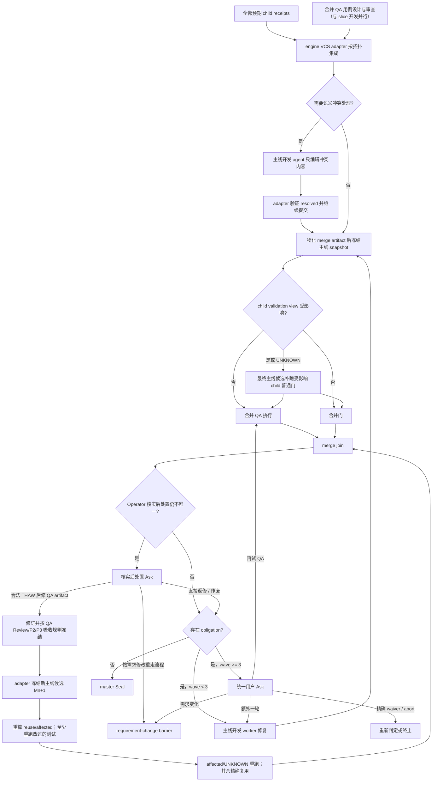

# formal-gates 确定性编排引擎最终实施方案

> 状态：完整需求与重大技术选择已由用户确认。
> 权威需求：`openspec/changes/orchestration-pipeline-engine/master-requirements.md`。
> 本文是当前实现方案；确认后的补充决定以对应原始记录为来源。实现细节以权威需求为准，公共操作和机械材料归属见 `SKILL.md` 与 `references/formal-flow.md`。

## 1. 最终形态

formal-gates 由 Go 引擎计算完整下一步；程序在本 run 选定平台派发已签发动作、收取原始结果并续做职责，主代理呈现实际用户决定。引擎是唯一流程权威，最终交付树不保留旧 run 迁移、旧公开推进命令、兼容别名、legacy mode 或 engine→legacy 回退。

两项目标等权：流程不能因漏步骤、选错分支或选择性忽略并行任务而卡死；主代理也不再消耗 token 推理下一步。验收采用结构性标准：主代理看不到迁移表和 pre 条件，不选择 Ready 子集，只接收固定、短小的类型化指令。

本次覆盖：

- regular 非分片、retained master、child、merge 和 lightweight；
- Git、SVN、P4 的非分片与分片全流程；
- Claude Code、Codex、Cursor、DeepSeek Harness、ZCode 的原生 adapter；每个平台的真实验证资格独立取证，额度与能力限制如实记录；
- 产品审、技术审、开发、黑盒/白盒 QA、门、修复、需求变化、中断恢复、Seal/Abort；
- 严格拒绝旧 run；不承诺 Windows/macOS/Linux 支持矩阵，但实现保持可移植。

## 2. 公共入口与控制循环

### 2.1 公共面穷举

workflow 的原状态入口如下；完整参数由当前 CLI 与 `references/formal-flow.md` 持有：

1. `workflow start`：唯一 bootstrap 写入口。
2. `workflow drive`：无外部事件，推进到下一外部边界。
3. `workflow submit`：唯一流程决定、控制事件与外部执行结果的接纳写入口。
4. `workflow show`、`status`、`next`、`diagnose`、`progress`：观测严格只读；`next` 接收语义选择时只准备确认候选，不接纳决定。
5. `workflow guard-preview --input <basis.json>`：公开只读、非权威的生产 guard 计算预览（schema/fixture 见 `references/guard-preview.md`），不创建 run、不写状态、不认证真实确认或任务合法性。预览不授予执行资格；实际 issuance guard 使用权威 engine 状态。
6. `workflow message`、`handoff`、`replan`：分别沿原 action 的消息队列、recovery 和需求/计划确认 owner 处理语义输入，不新增独立任务、编排状态或结果接纳通道。

`requirement` 只编辑需求/方案的新语义，程序保留原文、ID 并构造固定结构；`settings` 使用原字段选择。已知身份、路径、revision、digest、收据、候选全集和已有命令均由程序取得，角色只提交语义或原序号选择。

安装、卸载、hook、lifecycle、canary 与脱离 run 的快速 gate 检查属于维护/诊断面，不得绕过 engine 修改 workflow 状态。业务能力的 engine 内部 handler 归属见总需求 §3.2。

### 2.2 主循环

```text
start -> drive -> 程序消费当前签发动作与原生结果 -> 继续原任务
                 | Ask:      展示原确认候选 -> 等待真实用户决定 -> submit 原候选
                 | 具体阻塞: 保留原事实，等待必要输入或恢复
                 | Complete: 结束
```

Ready/HostAction 使用当前材料与签发身份执行；语义 Operator 由原角色判断并通过原
validator 接纳，不能由程序臆断。程序原样组装材料与身份并核验实际调用，主代理只负责新语义、证据含义和用户确认。控制 submit 沿同一消费者继续；worker receipt/result 使用同一接纳 owner，正常执行和恢复携同一原 job 的 request/process/exit/source。`--single-step` 仅作为同路径维护诊断，返回后不消费后续原生任务。


`NextResult` 是 tagged union，只允许 `Ready`、`HostAction`、`Ask`、`Wait`、`Operator`、`Complete` 六种 Kind。一个 canonical Plan 只能有一个 Kind，对应之外的 payload 必须为空。一个 Ready 可包含多个任务，且必须是整个 IssuedSet。

### 2.3 主动控制

route-add/reselect、需求变化、reset、abort、adopt-external、主动复审、fresh dispatch、QA 重跑和提前 waiver 都不能恢复成自由写命令。程序从带 freshness 的 `availableActions` 或受限 `REQUEST_*` 请求创建 pending Ask，按原 Ask 序号和语义选择准备完整确认候选；展示并取得真实确认后，submit 消费保存的原候选。request/token、目标、revision 和原对象由程序绑定，不由模型转抄。

Operator 只能核实事实和提出候选动作，不能替用户授权。

## 3. 确定性内核

### 3.1 三段式决策

1. `Observe(state, external facts)`：只读收集 VCS、文件、宿主、lifecycle、receipt 和容量事实，生成带 source bindings 的 observation。
2. `Decide(state, observation)`：纯函数，输出字节级稳定的 canonical Plan；不得包含随机 actionID 或当前时间。
3. `SelectIssued(plan, admission)`：只按固定顺序和真实容量机械选择动作并派生基础 actionID；由 protocol 的 `issueInto` 登记最终 actionID、Attempt 与 pending action，再经 `commit` 事务持久化。

迁移表只管理少量 run-level phase；动态任务由 `expectedTasks`、`TaskKey` 和 `TaskTransitionTable` 管理。单个 task 状态为 `QUEUED / ISSUED / RUNNING / VALIDATING / TERMINAL`，先推进 task，再由完整 expected set 的 join 推进 phase。

run phase 与合法边由 `internal/engine/runtime/phase.go` 持有；本文不维护第二份枚举表。用户节点和外部可观察语义仍按已确认需求验收。

### 3.2 程序化优先与节点内执行计划

已知控制流由程序执行，非确定性语义工作进入 agent 节点；持久化粒度跟随恢复和副作用边界。定义编译、理由枚举和禁止动态降级的判据由总需求 §5 与 ADR-001 持有。

执行责任拆成两个正交维度：

| 维度 | 枚举 | 含义 |
| --- | --- | --- |
| `DecisionAuthority` | `ENGINE` / `AGENT` / `HUMAN` | 谁拥有该步输出的判断权 |
| `RunnerKind` | `ENGINE_LOCAL` / `DURABLE_ACTIVITY` / `HOST_ADAPTER` / `AGENT_WORKER` | 该步在哪里、以何种可靠性边界执行 |

HOST 不是判断权。它只提供凭据、UI、进程或外部系统能力；HUMAN 只能通过 typed Ask；AGENT 只允许以下 `nonProgrammableReason`：

- `SEMANTIC_JUDGMENT`：证据含义、影响范围、冲突意图等无法由确定性规则完备判断；
- `CREATIVE_IMPLEMENTATION`：在已确认范围内设计或编辑代码、测试、文档；
- `INDEPENDENT_REVIEW`：需要新鲜、隔离的产品/技术/QA/门审判断。

外部边界到这两个维度的映射也固定：

| 边界/步骤 | DecisionAuthority | RunnerKind | 约束 |
| --- | --- | --- | --- |
| engine handler | `ENGINE` | `ENGINE_LOCAL` / `DURABLE_ACTIVITY` | 只走定义中的 next/failure edge |
| Ready dispatch transport | `ENGINE` | `HOST_ADAPTER` | 固定程序化派发协议的 `AGENT_DISPATCH_API` 边界；回 SpawnReceipt，与 worker 共用 actionID/TaskKey/Attempt，不另编 StepSpec 或增加 typed 字段；spawn 不属于 HostAction |
| Ready worker task | `AGENT` | `AGENT_WORKER` | 必须有合法 nonProgrammableReason；回 worker result |
| Operator | `AGENT` | `AGENT_WORKER` | 语义 worker 只返回 `SEMANTIC_JUDGMENT`；程序按原输入组装 typed observation，不替用户授权、不执行 adapter 动作 |
| Ask | `HUMAN` | `HOST_ADAPTER` | `hostBoundaryReason=USER_IO_TRANSPORT`，只有 request 中的合法选项 |
| HostAction | `ENGINE` | `HOST_ADAPTER` | 宿主只执行已签发参数并回 receipt |
| Wait / Complete | `ENGINE` | `ENGINE_LOCAL` | 只投影状态，不产生隐藏动作 |

“实现麻烦”不是代理理由。缺程序化 adapter 时只在开发期 diagnostic compiler mode 给未完成 definition 标记 `MISSING_ENGINE_ADAPTER`，不能临时把命令顺序交给代理。该 marker 不是 RunnerKind/hostBoundaryReason：不得生成 executable StepSpec，不得签发 Ready/HostAction；normal compile/drive 以 `BLOCKED_BUG` 和 diagnose 拒绝。最终候选的本次范围内定义不得残留。可执行 HOST_ADAPTER 的合法 `hostBoundaryReason` 只有 `EXTERNAL_CAPABILITY_BOUNDARY`、`USER_IO_TRANSPORT`、`AGENT_DISPATCH_API`。

`NodeExecutionPlan` 是 `CompiledDefinition` 中同一 nodeId 的步骤按 ordinal 排列的子序列，不设第二份节点结构（ADR-001“编译制品与节点映射”）。定义的唯一 authoring 形态是封闭 Go 类型变体 + constructor + 显式节点/步骤表（`LocalStep`、`DurableStep`、`AgentStep`、`HumanAskStep`、`HostActionStep`、`ParallelStep` 等，详见 ADR-001）：变体只暴露自己适用的字段，local step 看不到 receipt/join/agent reason，human step 填不了 retry/side-effect；`DecisionAuthority`/`RunnerKind` 由变体自动派生并在制品中物化，作者不手填。编译产物是具体结构组成的 `CompiledDefinition`，其步骤同样采用公共头（id/nodeId/ordinal/dependencies/kind/definitionVersion）加封闭变体 payload（`CompiledLocalStep`、`CompiledDurableStep`、`CompiledAgentStep`、`CompiledHumanAskStep`、`CompiledHostActionStep`、`CompiledParallelStep`）的结构——变体不适用的策略字段不得存在于该步骤，不得实现为全字段平铺的单结构。`StepSpec` 的跨变体字段如下，各变体只承载适用项：

```text
id / nodeId / ordinal / dependencies
executable preconditions / postconditions（封闭 predicate ID）
decisionAuthority / runnerKind（编译器派生并物化）
input/output codec ID（typed I/O）
retryPolicy / timeout
idempotencyKeyStrategy
sideEffectProtocol / receiptPolicy
interruptPolicy
parallelGroup / joinPolicy
failureClassMap
definitionVersion
nonProgrammableReason | hostBoundaryReason（按变体必填）
handler / predicate / codec / reconcile 的稳定 registry ID
```

以下任一条件成立就必须拆成 Controller 跟踪的 StepSpec：需要独立恢复、重试、超时、补偿或幂等；含不可逆副作用或 UNKNOWN receipt；跨越人/代理边界；形成 fan-out/fan-in；需要独立审计、版本或证据；崩溃恢复时必须避免重放已完成前缀。纯内存、廉价、确定性的连续变换，或能在一个原子/幂等事务中共同恢复的操作，可保留在同一 engine handler，代码顺序本身就是机械顺序。例外仅限 Ready 的固定派发协议：transport 已由原 native owner、typed SpawnReceipt 和 lifecycle 事实独立持久跟踪时，可与 worker result 共用一个 `CompiledAgentStep`；两边的完成、失败与恢复仍由各自原执行事实跟踪（总需求 §5.12）。

八类非法定义拒绝结果全部保留，拦截层按 enforcement matrix 分工——局部非法组合优先由封闭类型与 constructor 消除（Go 无编译器穷举的 sum type，“非法状态不可表示”指正常 authoring API 下不可构造；compiler 仍拒绝 nil、未知变体与零值），全局图不变量由小型 closed-world compiler 校验，runtime loader 对版本绑定做最后防线：

| 非法定义 | 主要拦截层 | 二次防线 |
| --- | --- | --- |
| 不可达 step / 非法循环 | graph compiler | property test |
| 无类型 I/O | typed constructor / codec registry | compiler |
| 自然语言-only pre/postcondition | predicate 类型 / constructor | compiler |
| 副作用无 idempotency/reconcile | durable constructor | compiler |
| human wait 无 request/schema | HumanAsk constructor | compiler |
| 并行组无 join/failure policy | parallel constructor | graph compiler（join 目标存在且覆盖完整 fan-out） |
| AGENT/HOST 缺合法 reason | 变体 constructor | compiled IR 校验 |
| 未绑定 definition version | compiler / encoder | runtime loader |

compiler 只检查它能机械证明的事情（registry ID 存在/唯一/kind 匹配、图不变量、版本绑定），不证明 predicate 语义正确——“编译成功”不替代行为测试；也不解释业务表达式。`MISSING_ENGINE_ADAPTER` 及一切未完整实现的定义只能以 diagnostic-only 形式存在：可输出诊断，不得编译为 executable plan、不得签发 Ready/HostAction、不得进入 promotion；executable definition 只有在同一候选包 registry 完整解析其全部 ID 时才能激活（definition 与二进制锁步）。运行时只执行当前 eligible frontier，拒绝乱序、遗漏和重复 step。AGENT_WORKER 只收到当前已解锁 step 的最小输入、typed output contract 和 postcondition，不能选择后续 step。HandlerID 标识可恢复执行合同而非每一版实现：合同不兼容变化必须晋升 ID，合同兼容的实现变化保持 ID、由 PackageDigest 标识。

错误不得动态降级给 agent/LLM：

| FailureClass | 唯一合法去向 |
| --- | --- |
| `TRANSIENT_ENGINE_ERROR` | 绑定未变时按有限 retry/backoff 自动恢复；外部派发缺显式策略时用 canonical `MaxAttempts=2`，耗尽后 typed Ask 或显式失败 |
| `BUSINESS_REJECT` | definition 中声明的业务边 |
| `USER_ACTION_REQUIRED` | Ask 或 Wait |
| `SIDE_EFFECT_UNKNOWN` | observe/reconcile，再到 Wait 或 Operator |
| `INVARIANT_VIOLATION` / `BLOCKED_BUG` | 显式失败并提供 diagnose |
| `AGENT_RECOVERABLE_SEMANTIC_ERROR` | 仅定义预先声明时进入 agent 语义修复 |

### 3.3 状态与并发写

`state.json` 是唯一权威工作流投影，使用原子替换、完整性摘要、快照和短时跨进程文件锁。状态包括：

- `workflowDefinitionVersion` 与 `stateSchemaVersion`；
- 单调 `revision`，仅用于 CAS；
- `pendingActions[actionID]`；
- task/dispatch/Attempt 与 source bindings；
- pending Ask、available-action freshness、obligations、impact set；
- 用户确认的 `granularity_review`、Batch/Subtask 计划及其 digest（按需求/方案 revision、拆分决定和路线绑定）；
- typed `ReviewScopeMode` 与逐项 QA approved whitelist（按 review/candidate/result 绑定）；
- 已确认 `requiredSources`、`AcceptanceManifest`、source↔point↔case map 及其 digest（按需求/方案 revision、route/topology scope 绑定）；
- split topology、`sliceID -> childRunID` 与 receipts；
- terminal summary 的最后 request/event receipt；
- `definitionDigest` 与 owning runtime `packageDigest` 的双重绑定与校验记录。

写事务为：读 state → Observe → Decide → 加锁重读 → 校验 revision → 重验外部 fingerprint → 持久化 intent/动作与 revision+1 → 原子保存。外部事实变化则释放锁重算，不依据过期 HEAD 或需求摘要推进。

本期不引入事件溯源、SQLite、watchdog、OS 定时器、repo 级集成队列或开放式通用 Effect/Artifact 框架。StepSpec 中的 side-effect/receipt policy 与 artifact schema 必须是定义里穷举的 typed variant，不能变成任意脚本/字符串扩展点。

三类 canonical 身份职责分离且不得混用：DefinitionDigest 绑定拓扑、handler/predicate/codec ID、策略与 join/failure 语义；PackageDigest 绑定真正的实现字节、二进制与安装包资源；PlanDigest 绑定给定 state+observation 的决策结果。PackageDigest 是 owning-runtime 执行绑定而非审计附注：loader 在写入前必须校验 envelope 的 package digest 与实际执行 runtime 的安装身份一致（或由 run 绑定的不可变 runtime sibling 执行并验证其实际摘要，或持有显式 adopt receipt），不得仅凭 HandlerID 相同接受新实现接管旧 run。

### 3.4 submit 幂等与新鲜度

每个外部事件验证 event/request/action ID、当前节点、schema、payload digest、dispatch/Attempt 与 source bindings：

- 同 ID、同 digest：返回稳定 acceptance/status，不再次签发已经 ISSUED 的 SpawnRequest；
- 同 ID、不同 digest：硬拒绝；
- 新 Attempt 已建立后的旧结果：以 `OBSOLETE_RESULT` 可见拒绝；
- result-before-receipt：暂存，lifecycle 对账成功后接纳；
- 终态最后一个相同事件：由 durable summary 幂等重放结果。

### 3.5 开发分块计划进入引擎的机械流程

开发分块沿用 ADR-002 的 Batch/Subtask 模型，不与 Run 级 `slicing`（master/child 拓扑）
混为一谈。分块的语义判断由 Part 2 技术审提出、用户确认；引擎只负责把已确认计划变成
可校验、可执行的任务绑定，不从自然语言重新猜测粒度。

固定接入顺序如下：

1. Part 2 `start-readiness` 产出结构化 `granularity_review`：记录需求/方案 revision、
   拆分决定、单一或多个 Batch、`Batch → Subtask` 映射、每个 Batch 的交付物、DoD/测试、
   依赖、接口/状态边界、风险、回滚/恢复、交接与上下文成本，以及不拆或改拆理由。
2. Controller 在用户确认后校验该计划：ID 唯一，Batch/Subtask 映射无遗漏和重复，
   TaskKey 归属明确，批间依赖无环，必需的 DoD/验证/恢复/交接字段齐全；通过后保存
   `granularity_review` 与计划摘要及其 digest，并绑定当前需求/方案、路线和拓扑。
3. 引擎把 Batch 映射为现有 TaskKey 的分组与依赖信息，不新增 Batch 独立状态机。批次完成
   由成员 task 的终态和该批已登记的 DoD/验证/交接结果派生。
4. `development-worker` 派发必须带 `batch_id`；一个 `batch_id` 只能对应一次开发派发。
   同一派发中的 `subtask_id` 只是顺序步骤，不能单独派发、不能触发换代理或 reset。
5. 前一 Batch 的成员任务、DoD、验证和交接均完成后，Controller 才把下一 Batch 放入
   eligible frontier；跨 Batch 才允许准备新的零上下文开发代理。Batch 契约、接口、依赖
   或 DoD 变化时，原计划和未完成派发失效，必须重新做 `granularity_review` 并取得用户确认。

这里的“机械”只保证结构完整、顺序、绑定和代理边界正确；是否值得拆、拆分是否符合产品
语义，仍属于技术审和用户决定，不由引擎自动优化。

## 4. 受理、用户节点与审查

### 4.1 宿主受理

普通修改请求只提醒一次可使用 formal-gates；复杂请求在完整需求/方案确认后、动手前再提醒一次。提醒均不需要用户回应，也不阻塞直接处理。

用户主动提出 formal-gates 后直接进入受理，不再重复问“是否进入正式流程”。主代理逐项澄清需求和重大技术选择，然后单独请求确认完整整合后的需求与方案；只有确认后才能 `start`。`start` 后首个 `drive` 自动登记 intake receipt/digest，不再次询问同一份确认。

regular 受理不要求用户原始输入采用 OpenSpec、PRD 或其他固定格式。主代理通过 `requirement` 提交对齐后的新语义，程序直接构造唯一正式 UTF-8 Markdown 需求案，保留未改原文与已有 ID，不另建草稿或人工覆盖清单；固定 `REQ → 要求/验收条件/来源` 与 `AC` 结构由程序生成，语义内容覆盖全部必须实现、会改变产品/流程行为或必须进入 QA 保证的义务。确定性预检只校验结构、字段、唯一性与边界，预检通过后仍由用户确认当前完整文件和 revision。纯实现位置、代码边界或未来迁移约束若不改变产品/流程行为，留在方案正文并由技术审、diff、代码审查或实现质量门验证，不伪装成必须 QA 的 `AC`。lightweight 继续只登记需求后 Seal，不写该正式需求案。

受理 owner 根据确定性预检生成的完整候选与用户对全文/revision 的明确确认，保存 typed
`intakeConfirmationReceipt`。来源、authority 与 transport 使用当前协议的固定值，程序
传递原对象与工件绑定，不要求模型手抄 identity/digest。`start` 校验确认来源、当前工件
与结构一致，旧 receipt 配当前不同工件在首写前拒绝。

若用户尚未明确，受理时选择 lightweight 或 regular。lightweight 是 bootstrap 例外，不经拆分和 default/full/custom 路线，登记需求后直接 Seal 并标记 unverified；regular 不能在运行中改成 lightweight。

### 4.2 正常 Ask

正常流程只在用户拥有决定权时 Ask：

1. lightweight/regular（尚未明确时）；
2. 高置信拆分建议的精确拓扑，包括边界、数量、依赖和并行度；
3. regular 非分片 run 和每个 child 的 default/full/custom 路线：非分片 default 选择全部普通门、不含双 QA；full 选择全部普通门与双 QA（QA 阶段较重，适合大型任务）；custom 可选非空子集或全集并保留身份。child 不含普通 QA，default/full 均选择全部普通门。来源为 `references/formal-flow.md` 与当前 `internal/engine/protocol/review.go`；推荐仍须用户确认。
4. 经 Operator 核实成立的产品审/技术审每条 P0–P3 finding 的 confirm/dismiss，以及对已接纳 review finding/adjudication 的语义纠正；Ask 已附唯一完整 remedy 时 confirm 同时批准 remedy，存在多个用户拥有的修法或纠正选项时继续澄清并按 §5.1 确认完整候选的 review-delta。

child 路线可在界面批量接受统一默认，但状态中逐 child 保存独立决定。低置信不拆或不确定由引擎自动记录 no-split 理由，不制造无意义 Ask。

### 4.3 条件 Ask

以下只在事实或用户主动请求触发时出现：

- route-add/reselect；
- 任意 ACTIVE 非终态阶段的需求变化；
- adopt-external、带精确保留/清除预览的 reset、abort；
- 原因未知且 bindings 未变的中断：resume/fresh/abort；
- 产品审或技术审已经完成当前有效上限内的三轮语义审查、但按 finding 处置规则仍需新鲜复审；
- 黑盒、白盒和 merge QA 三类 pre-wave review 各自三连 FAIL 或长期不可用；
- 用户主动要求的 review override、已 PASS 复审、fresh dispatch、QA 重跑、提前精确 waiver；
- 用户主动要求纠正已接纳的产品审/技术审 finding、严重度或 adjudication；
- 开发后 QA/门 finding 经 Operator semantic adjudication 核实严重度、范围、根因与重复关系后，实际处置仍有多个合法分支时才 `VALIDATION_DETAIL_DISPOSITION` Ask；核实不是用户 Ask；
- 开发后 `wave >= 3` 的统一处置；
- 长期 RUNTIME_ERROR；
- master/child 破坏性级联。

此外，任意 ACTIVE、非终态节点都提供 HUMAN 用户 typed 控制 Ask。用户可授权从当前节点跳到任意合法业务节点；程序请求携原 freshness token、request ID、requirement revision 与 from/to，用户只决定目标与理由，授权后由程序保存 receipt。Controller 在跳转前先 suspend/quarantine/invalidate/reconcile 受影响 Attempt、结果、候选和副作用；终止目标仍走统一 cleanup。

正常 Seal 自动执行，不额外询问。

### 4.4 产品审和技术审

reviewer 输出只是候选。Operator 对每条 P0/P1/P2/P3 核实需求前提、正常入口、复现、证据、因果、严重度和范围；无效或范围外候选直接丢弃。有效 finding 获得稳定 ID+digest，再逐项 Ask。Ask 同时记录 finding disposition 与 remedy authorization：若附带唯一、完整、无用户选择空间的 remedy，confirm 绑定两者 digest；若用户只确认问题或仍有多个有意义的产品/重大技术选项，先继续澄清、取得选择并按 §5.1 确认完整候选的 review-delta，不能由代理自行选修法。纯机械同步不重复 Ask。

审查状态分为三层 typed data：不可变的 `RawReviewCandidate`（绑定 action/TaskKey/dispatch/result digest 与需求 revision）、逐 finding 的 `ReviewAdjudication` 及可 supersede 它的 `ReviewCorrectionReceipt`、由 Controller 纯函数计算的 `EffectiveReviewStatus`。原始 candidate 只作证据，不得由 Operator、host 或 submit 直接写成权威 PASS/FAIL；只有完成结构/binding/完整性校验并经 Operator 核实后的 finding 才进入 adjudication。用户确认的语义纠正通过带 freshness 的 typed Ask/submit 写入 correction receipt；程序可直接拒绝错误 binding、incomplete 或 stale candidate，但不能代替用户改产品/重大技术判断。

ACTIVE、非终态 run 允许针对精确 finding/adjudication 纠正无效性、严重度或错误裁决。纠正绑定 run、action、TaskKey/dispatch/result digest、需求 revision、目标 finding digest、旧/新值、原因和授权 receipt；同一 freshness 下幂等，不同 digest 冲突拒绝。原始 candidate 与旧 adjudication 不删除，只标记被 receipt supersede；这是一组有界 typed records，仍保存在单一 `state.json` 投影中，不引入事件溯源。Controller 每次接纳 disposition/correction 后重算 effective status 和依赖失效：未处置或已确认 P0/P1 阻塞；仅 P2/P3 为 PASS+advisory；全部 P0/P1 被驳回/判无效且无其他 blocker 时直接 PASS，不签发只为改聚合状态的 fresh review。若纠正把 PASS 改为阻塞，依赖它的后续结果按依赖图 stale；若只清除错误阻塞，立即开放下一合法节点。

Controller 按 master/整体 run 和审查动作分别持久化两条独立的 `PreDevelopmentReviewSeries`：`product-review` 与 `start-readiness`。每条 series 默认允许完成三轮语义审查；只有 Operator 接纳的完整、有效 `PASS` 或 `FAIL` 结果才完成并消耗一轮，`RUNTIME_ERROR`、无效结果、未完成派发、中断以及 stale result 不计轮。前三轮是 workflow policy 预授权的上限，不要求一次性创建或提前派完；只有当前 finding 处置确实要求 fresh review 时，Controller 才为下一轮生成绑定当前 revision 和轮次的 distinct external `TaskKey`。

完成第 3 轮后若仍需 fresh review，Controller 不再自动签发第 4 轮，而是返回 action-specific typed Ask，展示当前完整文档 revision、已完成轮数、未闭环 finding/remedy 和风险。用户每次只能为该动作授权恰好一轮；授权形成带 request ID、reason、action、revision 与 granted round 的 receipt，并只向 expected task set 增加一个 fresh-review slot，不能预先累计，也不能转给另一动作。额外一轮后仍需复审则重复同型 Ask。单轮 TaskKey 内的瞬态失败仍单独受有限 `RetryPolicy.MaxAttempts` 约束；retry attempt 不增加语义轮数，语义轮授权也不增加 retry 余量。

两条 series 贯穿同一整体 run：需求/方案 revision 变化、impact invalidation、carry、adopt-external 和普通结果失效均不清零已完成轮数或授权记录；显式 workflow reset 或新 run 才建立新的默认额度。split child 继承 master 已完成的整体产品审/技术审，不创建自己的独立 series。`show/status/next` 必须分别显示 completed、base limit、extra grants、effective limit、remaining 和授权来源，并在到达边界时显示 Ask，不能伪装成 Wait 或 runtime error。

- P0/P1 confirm：来源记为 `REVIEW_FINDING_FIX`；修订后由新的零上下文代理读取完整最新文档进行新鲜复审，不得做增量 carry。
- P0/P1 dismiss：finding 作废；若无其他已确认 P0/P1，可接受候选结果，不因驳回项再派一轮。
- P2/P3 confirm：有界修订/修复；默认 meaning-preserved，不清审、不重审、不消耗审查轮次。只有用户在原修订确认 Ask 中声明 meaning-changed 后才按真实来源与影响复审，Operator 与程序不能自行升级含义分类。
- P2/P3 dismiss：作废。

产品修订改变技术前提时，产品复审 PASS 后再做新鲜技术审；技术修订改变产品语义时先回完整产品复审。后续提示词携带已拍板 finding ID，前提未变时不得原样重提。

`PreDevelopmentReviewSeries.completed` 从完整、有效语义审查集合投影：一轮完整审查即使 finding 后续被确认、驳回、改严重度或使 effective status 在 PASS/FAIL 间变化，仍只计一次；整轮被 correction 判为 invalid/incomplete/stale/错误绑定时才从 completed 集合排除。correction 既不生成新 TaskKey，也不消费额外 review grant 或 retry attempt。

## 5. 任意时点的用户需求变化

`REQUEST_REQUIREMENT_CHANGE` 在 Ask、Wait、Ready、Operator、产品/技术审、路线、开发、QA/门、修复、分片、主线集成和尚未完成的 Seal intent 中都可达。SEALED/ABORTED 后则创建新 run。

处理顺序固定：

1. Phase A 立即撤销未完成 Seal intent，停止新的权威 VCS/状态写入、candidate promotion 和业务任务签发。尚未有确认后的 `ImpactSet`，不得先猜哪些任务不受影响。
2. 已签发且可安全隔离、不会提交权威副作用的计算/agent 可继续到 terminal，但结果只进入 quarantine，不推进 workflow；其余安全 suspend/terminate。此阶段暂时没有 eligible 任务不违反最大并行。
3. 用户澄清并确认完整最新版需求/方案。
4. Operator 基于程序提供的旧/新完整材料判断 changed items、transitive impacts、affected tasks/artifacts 与 carry reasons；程序绑定原 revision 和工作身份形成 `ImpactSet`。无法证明未受影响的一律建议 affected；该建议不授权执行。
5. 用户在原 typed Ask 中逐项确认或调整已走环节及结果的 `CARRY/REDO`。程序展示完整候选并绑定原 work/child、revision 和理由；用户未决定前不得自动失效、重放或豁免已走环节。确认后 Phase B 机械 terminate/stale 用户选择重走的 Attempt 和结果，恢复或接纳用户选择续用的 quarantine 结果并携原 revision、证据和理由写 carry receipt；SelectIssued 立即按新 frontier 填满兼容容量。
6. 仅 `USER_INITIATED_CHANGE` 可用增量产品审/技术审：reviewer 读取完整文档作上下文，只重新判断变化及传递影响；影响无法可靠圈定时扩大为全量。
7. QA cases、路线、拆分、开发和验证结果按同一用户已确认的 ImpactSet 与逐项决定更新；持久化 typed `ReviewScopeMode` 规定黑盒/白盒 QA 用例或测试审查首次建立基线为 `FULL`，后续新增、修改或 ImpactSet 受影响项为 `AFFECTED`；产品审、技术审和普通质量门始终为 `FULL`，并保留未来开放用户配置的类型能力。

用户需求变化不增加或清零 run 级 repair wave，也不清零产品审/技术审的 `PreDevelopmentReviewSeries`；被变化打断、未形成完整有效结果的旧 revision 审查不计语义轮，被变化打断、未形成完整 expected set 的旧 revision wave 不计开发后 wave。分片由 master 统一接收和级联：未受影响 child 可 carry，受影响 child 重建或重验；已进入主线集成时，普通增量由主线开发 worker 实现，拓扑变化才重建受影响 child/map/receipt。

### 5.1 需求内容确认与回退授权

审查来源的修订必须使用与上一确认 revision 匹配的原完整 base，只提交新语义；原角色逐项核实穷尽本次修订的 review-delta 含义与来源，不允许无关 hunk 混入。程序从原确认事实、当前正式文件和语义输入装配候选及 base/candidate revision、delta/impact digest 和收据绑定，模型不重拼原文、差异身份或确认外壳，不另建 base/diff 账本。用户只确认变更包；完整 candidate revision 绑定为新需求，未变内容继承。首次受理仍确认全文，主动查看全文不改变增量确认范围。公共操作沿 `references/formal-flow.md` 的原确认候选入口。

需求影响由 Operator 建议，Controller 不判断自然语言含义。`meaning-preserved` 不产生回退 Ask，保留产品审 PASS，只重做实际受影响、未通过或尚未完成的技术审；正文变化仍按 review-delta 确认。`meaning-changed` 在接纳 revision 转换前必须生成绑定 state revision、base/candidate revision、影响预览 digest 的 typed Ask，展示目标/范围/对外行为/验收变化、失效 PASS、回退步骤、产品审已用/剩余额度和授权状态。只有用户确认事件才能原子登记新 revision、作废旧产品审 PASS、置产品审 PENDING 并使下游失效；不重置额度、不自动授权新产品审。缺失、过期或不匹配时零状态变化。一次决定明确覆盖 review-delta 与回退后果即可共用授权。engine 是唯一 writer，其他入口不得绕过校验。


## 6. 强制最大并行

完整 eligible frontier 由 `expectedTasks` 计算，引擎和宿主必须满足以下不变量：

1. 可用容量为 C、eligible task 为 N 时，签发恰好 `min(C,N)` 个任务；顺序固定。
2. 程序在原平台消费完整 IssuedSet，不得挑子集；主代理不搬运或重拼派发材料。
3. receipt/result 释放容量后，`submit` 自动继续推进并补满下一批。
4. 一条支路 FAIL/RUNTIME_ERROR 不压住仍独立 eligible 的其他支路。
5. adapter 无可靠 correlation 时只可串行化尚未 attach 的 start handshake；已 ACK worker 和其他兼容容量继续并行。

关键并行组：

- 普通非分片开发期：开发 worker + 黑盒 QA 用例设计/审查；
- 分片开发期：各 slice 开发 + 合并 QA 跨片用例设计/审查；
- 普通非分片 run 选择白盒时，开发实现快照 Dn/S1 后：只解锁白盒设计/authoring；白盒测试提交为 Qn/S2，QA Review 与 P2/P3 吸收若修改测试继续提交，直至所有 mode 的最终 case-set FROZEN 且绑定含测试快照；
- 最终 review-ready 候选就绪后：一次冻结 expected-set/digest，全部 eligible QA execution 与 selected gates 同时准备并最大并行，均绑定该最终候选；
- 合并后：合并 QA 执行 + 合并门；
- 修复后：所有受影响且依赖满足的验证再次最大 fan-out。

review-ready 是执行屏障：之前不提前签发黑盒执行或门，也不用 provisional 结果代替最终候选验证。普通实现返修沿用 FROZEN 用例，不重新设计。

## 7. 开发后 QA、门与三轮

普通黑盒/白盒 QA 的候选与审查义务适用于非分片 run；child 只冻结完整开发候选与适用普通门结果，分片集中 QA 遵循 §8。

```text
开发快照 Dn/S1 → 白盒设计并提交测试 Qn/S2
             → QA Review / P2/P3 吸收，变动继续提交
             → 全部 case-set FROZEN + 最终 review-ready 快照
             → 冻结 expected-set/digest，QA execution 与门整批并行
             → COLLECTING 收齐 → Operator 逐条核实/归并
             → 无 obligation：提升/Seal；有 obligation：同快照唯一返修
```

开发后 raw finding 由 Operator semantic adjudication 核实需求、正常失败场景、模块、根因、后果；
原角色只返回独立 severity rationale、范围/严重度/因果/复现证据与 NEW/SAME_AS/DISMISSED
语义裁决，程序携原 finding/problem ID 保存结果与历史。Controller 只做结构完整性、引用/版本绑定和机械路由，
不判断语义真假、严重度是否成立、根因或重复关系。P1 理由须说明需求、正常路径、实际后果和
为何 P2 不足，P0 还须证明需求不成立、核心验收无可用路径或交付受阻；条目 FAIL、批量套话
不能代替逐条理由。产品/技术审 finding 的 confirm/dismiss Ask 保持原规则。

仅已核实 finding 的处置仍不唯一时才 Ask；核实本身属于 Operator。wave 目标未收齐、
PENDING/在途或运行错误未明确处置时不得返修。所有目标终结且 adjudication 完成后才生成
有效 obligation：QA FAIL、有效 P0/P1 与门审 P2 汇入同一快照唯一返修计划，同根因归并同一
problem。同一逻辑返修运行错误只重试同一 TaskKey，不能生成第二份返修计划。route、
case-set 或目标集变化使旧 wave 失效，不能改 expected-set 制造收齐；晚到结果只留审计，
错误的明确处置不伪装成 PASS。

- 门审 P2 必修、不复审、不增加审查轮次。纯门审 P2 worker 必须完整构建、全量测试、逐项
  自跑受影响用例，以绑定修复快照的完成/carry 凭据继承 gate PASS。
- 门审 P3 不修复，只在 Seal 前一次性 advisory；范围外 P3 同样不形成 obligation。
- QA Review P1 修订后 fresh review；集合级 P2/P3 按稳定 suggestion ID 吸收并留来源、不复审。
  全部吸收且覆盖通过才 FROZEN；无建议则 PASS 后立即冻结。
- 普通返修按 AFFECTED 验证冻结用例并核齐当前义务；不自动追加最终 FULL。
  只有需求含义、对外行为、成功/失败判据或稳定可执行性变化才能 THAW；临时环境失败是
  RUNTIME_ERROR。合法 QA artifact 修订重新装配并冻结候选，至少重跑改过测试和共享依赖项。
- 既有三轮自动审查与额外授权上限保持；完整 expected-set 终结才计 wave，装配、pre-wave
  review、未收齐、未完成裁决、未处置错误不计，纯门审 P2 修复不计。
- 额外返修先只读 preview，Ask 展示 state revision、需求/快照/wave、完整 findings/problems、
  逐条理由/归并、历史修复/验证、QA scope、已用/剩余轮数、dispatch signature/TaskKey、
  engine allowance、owner cost 和 token cap 可用性。授权绑定摘要 digest 与 state revision，
  任一绑定变化使旧授权失效，一次只授权一轮。

非 wave 与 wave action/QA/gate 共用无效结果义务生命周期：RUNTIME_ERROR 或
REJECTED_INVALID_RESULT 结束原 attempt；拒绝回执记录字段/原因，不写有效 finding、
PASS/FAIL/problem/basis。有效义务复用 TaskKey，默认 MaxAttempts=2；wave 重派还须
COLLECTING 且目标未处置。耗尽进入 RETRY_EXHAUSTED，展示原因与已用/总次数，停止普通和
自动重派。用户绑定 state revision、非空理由只能一次性追加一个 attempt；它只改变 retry
policy 与 budgetBasisDigest，不增加基础槽位。再次失败只能既有显式错误处置、abort/cleanup，
或确认真正改变 binding/snapshot/责任的新计划，不能无限授权。

dispatch signature 绑定具体输入，TaskKey 绑定逻辑义务；相同 OPEN 续用，相同有效 PASS
signature 不重复派发。guard 基础 source 为 closed-world definition、确认 requirement/
Batch/route/topology、批准 QA、所选 gate；finding 派生 source 仅来自 adjudication 完成且
wave 收齐后的有效 obligation/唯一 repair TaskKey。预授权 repair 机械加入，需确认的扩张先
确认 revision。raw finding、普通 result/receipt/resume 不扩容。
运行时 guard 在 engine 签发事务中核当前 state、已确认义务、attempt 与累计用量；guard-preview 只读呈现，不授予实际执行资格。owner cost 与 token cap 的 UNAVAILABLE 各按来源/配置独立判断。

### 7.1 完整候选与晚提升

每轮先冻结只含实现的 `DevelopmentSnapshot Dn`。选择白盒时，由 VCS adapter 从精确 `Dn` 创建已登记的独立 authoring workspace；白盒设计 agent 可新增/修改/删除被 `TestOwnershipResolver` 证明为 test-owned 的测试、辅助代码、fixture 与 case 内容，只返回新语义与完成情况。程序捕获原生差异并组装路径 manifest，Controller 校验后由 adapter track/open、commit/submit，冻结原生不可变的 `ValidationCandidate Qn`。`Qn` 必须同时包含实现、白盒测试代码及所有要纳入 VCS 的已批准最终 artifact。未选白盒时，Controller 仍在验证前物化这些 artifact，并令 `Qn` 等于装配后的实现候选。

VCS adapter 输出 `Dn→Qn` 全部 added/modified/deleted/renamed 路径与内容摘要；`TestOwnershipResolver` 结合项目/测试框架配置、路径/命名规则、测试发现和生产构建输入分类。名字带 `test` 不是充分条件，名字不带 `test` 也不自动排除；只有全部差异均 test-owned，且生产代码、运行配置、生产依赖、构建输入与 provider 元数据投影相等，才证明 production validation view 未变，UNKNOWN 按受影响处理。

白盒 Review 独占测试质量，测试变化（包括建议吸收）先由 adapter 提交；最终 FROZEN case-set
绑定含全部测试的 review-ready Qn 后才允许 QA execution 和门。门不接收 QA 用例正文、
逐用例执行证据或测试实现细节，仍审基线到最终快照完整 diff；实现质量门排除 test-owned 文件。合法 THAW 后的候选替换使
旧 wave 失效，新的 expected-set 只绑定新候选；普通实现返修保持冻结用例，按 AFFECTED 执行。

完整 wave 无 obligation 后，adapter 才把整个 `Qn` 提升到主线。Git 能 fast-forward 时保留同一 identity；SVN/P4 或其他 Git integration 产生最终身份 `F` 时，只有 typed `CandidatePromotionReceipt` 证明 source/target identity、预期 target base、完整路径与 provider 元数据、operation id、无冲突，以及 `validatedDigest(Qn) == finalDigest(F)`，整组结果才可映射到 `F`。这不是逐门 carry。若出现冲突、转换、目标漂移、UNKNOWN 或 digest 不等价，先 reconcile，再把实际结果冻结成新候选并重跑受影响验证。

覆盖契约先把同一次需求/方案确认中登记的有限 `requiredSources` 与当前 revision、
route/topology scope 一起冻结，再生成有限验收点集合 `AcceptanceManifest`，并用
source↔point↔case 映射建立双向追踪。标准需求案适配器直接把每个 `REQ` 投影为
`RequiredSource(PRODUCT_REQUIREMENT, QA)`、每个 `AC` 投影为 `AcceptancePoint`、已设计 QA case
投影为 `AcceptanceCase`，关系只由 `CoverageEdge` 表达；标准需求案中的全部 `AC` 都必须有
approved case，不允许使用“非 QA 验证处置”绕过。其他合法 source 才可按自身协议使用显式
非 QA 处置。review 必须显式返回完整 `SourceDecisions`、`PointDecisions`、`CaseDecisions` 和未绑定
集合；不得由 case PASS 自动推导或补写 source/point PASS，三层全部逐项 PASS 后才能生成
whitelist。仅有集合级 PASS 不足以通过。execution 冻结 expected case ID set，并列出
实际执行、合法继承和未执行条目；`FULL`/`AFFECTED` 都必须完整对账。source inventory/
manifest/map/whitelist digest 与当前 `ValidationCandidate` 精确绑定，摘要展开为
`sourceID → pointID → caseID → result`，`AUTHORIZED_SKIP` 不等同 `EXECUTED_PASS`。
Controller/validator 负责结构校验，覆盖率、mutation、property-based test 和 fuzz 只作辅助
信号，不设固定阈值。


## 8. 分片、主线合并与 VCS

### 8.1 生命周期

`start` 不接受也不冻结拆分意向（取消 `--split` 强制声明）。拆分绑定唯一发生在 start-readiness PASS 后的拓扑确认：高置信要拆时 Ask 精确拓扑，低置信不拆或不确定由 engine 自动记录 no-split 理由。拓扑确认即绑定点——确认前用户可改变意向、无需重启或 reset；确认后不得重切，变更走用户需求变化、reset/rebuild 或 abort。

master 确认拓扑后，Controller 执行固定 child-creation plan：ENGINE_LOCAL 持久化 intent、分配 childRunID、创建 PREPARING child state 并注入 bindings；每个 Git/SVN/P4 workspace/client 再由 VCS adapter 独立 StepSpec 创建/对账；ENGINE 校验全部 typed receipts/identity 后，才原子提交 `sliceID -> childRunID` map 并解锁 child。child 继承完整产品/技术审和拓扑，各自持久化 default/full/custom 路线；只开发并执行所选普通门，不选择、不执行普通黑盒/白盒 QA。

child 达标后进入可恢复 `SLICE_READY`，不独立最终 SEALED、不删除恢复信息。durable receipt 至少包含：

- 状态、child/slice/master ID；
- workflow/state schema version；
- 最终完整 child VCS identity、tree/validation digest 与 candidate-promotion receipt；
- requirement/topology/route bindings；
- 普通门结果、cost；`SelectedQA` 与 `ApprovedCases` 为空，明确未选择普通 QA；
- 最后 request/event digest 和幂等结果。

master 只按持久 map 接受预期 receipt，不扫描任意 sidecar 猜测 child 完成。child abort 产生 ABORTED receipt 并阻塞 master；master 的 abort/reset/重大需求变化按用户授权级联，不留 orphan。

### 8.2 合并路径

分片 QA 集中在 master 合并后执行；merge QA 的批准用例覆盖完整已确认需求与方案中适用的 QA 义务。master 最终 Seal 绑定这些用例和执行结果、完整 child receipt map 与成本；整体需求保证以这些当前证据为准。



合并后始终跑合并 QA 与合并门。Operator 完成新细节语义核实后实际处置仍不唯一时，才执行 `VALIDATION_DETAIL_DISPOSITION` Ask；用户选直接返修后才由主线开发 worker 修复，不回 child、不重新 Seal child、不重复路线或澄清。用户选修 QA artifact 时，必须在主线物化修改并冻结新候选，至少 fresh review/重跑改过的 merge 测试或用例，共享组件变化时扩大到所有依赖项；随后重新计算 merge gate、merge QA 和 child obligation 的 reuse/affected，不能直接回旧候选执行。每次冲突处置/主线 repair 后，Controller 用 topology ownership、VCS diff 和 child receipt 的 validation view 计算 `AffectedChildSet`：只改 integration-owned glue/跨片接缝且 child view 全部精确相等时，仍只重跑合并双验证；改变 child-owned 内容或 UNKNOWN 时，在同一最终主线候选上额外补跑对应 child 受影响的普通门义务，再与合并双验证 join。合并流程使用同一 wave 计数规则：处置完成后 `wave >= 3` 才作三轮 Ask。

### 8.3 VCS adapter

统一接口程序化覆盖 provider 探测、根/身份解析、status/diff/untracked 识别、base/current/ancestry、child workspace/client、显式 track/add/open/reopen、resolve 状态、integrate、commit/submit、snapshot、final identity、已授权 reset/rollback、cleanup 和 crash reconcile：

- Git：worktree/branch、集成和 Seal squash；
- SVN：working copy、revision 与集成，不 squash；
- P4：client/workspace、changelist 与集成，不 squash。

开发/修复 agent 只编辑已授权内容，返回语义说明与完成情况；程序捕获原生差异、组装声明式路径 manifest 和 typed result，Controller 校验后由 adapter 执行 VCS 写操作。确定性构建/测试由 engine runner 执行；只有测试设计或实现本身需要语义创造时才成为 AGENT step。

冲突路径严格固定：adapter 发起 integrate 并输出精确冲突集 → 若需要语义选择，主线开发 agent 只修改冲突内容 → adapter 验证 resolved → adapter 执行 resolve/add/open、commit/submit、snapshot 和确定性验证。agent 不运行 VCS 写命令、不决定集成顺序，也不把冲突退回 child。

reviewer/QA 读取 Controller 生成的只读 snapshot/diff artifact；artifact 绑定 provider、base/current、definition version 和 digest。reviewer 不自行推断 VCS 当前态、不执行 VCS 写操作。凭据/外部能力可通过 typed HostAction 执行，但宿主只能执行已签发参数，不能自造或重排命令。

whitebox authoring workspace、完整候选 freeze 和候选 promotion 也属于同一 VCS adapter 契约。promotion receipt 的 canonical validation view 对 Git 覆盖 tree/blob/mode 与相关引用，对 SVN 覆盖 path@revision、内容与 properties，对 P4 覆盖 depot paths、submitted changelist、filetypes 和 view；只比较工作区字节或只贴 `test-only` 标签均不足以把验证映射到最终身份。

检测外部漂移时，adapter 先冻结 observed identity、lineage、只读 diff 和 `ExternalAdoptionPreview`。adopt-external Ask 必须绑定该精确 identity；授权后保留原 run base，把外部 identity 设为新 current/development source，并写含旧/新 identity、request、preview、ImpactSet、invalidations/carry 的 `ExternalAdoptionReceipt`。affected/UNKNOWN Attempt、result、candidate、waiver、promotion intent 与 child receipt/map stale；明确未受影响项才 carry，未完成 wave 不计、已完成 run wave 不清零。需求 artifact 的语义变化转入 `REQUEST_REQUIREMENT_CHANGE`，lineage/identity 不唯一进入 Operator/Wait/reset/abort；分片只级联受影响 child 与 merge bindings。

所有非幂等 VCS 操作使用 intent/reconcile 协议，adapter 返回结构化 facts，流程层不得解析人类文本猜结果。adapter 错误只进入预声明的 retry、Wait、Operator 或显式失败；绝不改派 agent 猜测。

## 9. 宿主动作、中断与本地副作用

### 9.1 HostAction

spawn 只走 Ready。HostAction 是封闭 typed union：`RESUME_AGENT | TERMINATE_AGENT | EXECUTE_ADAPTER_OPERATION`；最后一类只引用 definition 注册的 adapter operation 和参数 schema，不能携自由 shell。每个动作先持久化 pending intent，再交给宿主。公共 receipt 字段为 actionID、operation、payload digest、宿主/provider、correlation 和 status；resume/terminate 另带 lifecycle evidence，adapter operation 另带其 schema 规定的结构化 observation/identity evidence。

provider identity、bridge installed/available 和 lifecycle paired status 分开记录。宿主是什么就绑定什么；bridge 缺失不得降级成 default。已安装桥但事件缺失先 Wait/对账，最终可 REJECTED/Operator；provider mismatch 硬拒绝。

中断与 UNKNOWN 分开处理：

- 客观瞬态且 bindings 未变：在该 Attempt 的有限 retry 余量内自动 resume；外部派发无显式
  策略时使用 canonical `MaxAttempts=2`，耗尽后进入 typed Ask；
- 新的有效义务或经确认的新计划改变 binding/snapshot/责任时，才使用新 TaskKey 和计划槽位，
  旧 Attempt terminate/stale；非瞬态错误本身不生成新义务，也不能借 fresh attempt 扩容；
- bindings 未变但原因未知：Ask resume/fresh/abort；
- receipt UNKNOWN：先查 lifecycle，唯一匹配自动 attach，多重/无匹配进 Operator，绝不盲目 respawn。

### 9.2 本地副作用

start、prompt/artifact、blackbox/whitebox QA worktree、case mirror/materialize、完整候选 freeze/promotion、Git/SVN/P4 workspace/集成/提交、snapshot、Git squash、child receipt/cost、terminal summary、cleanup、abort 全部采用 StepSpec 与：

```text
persist intent -> execute -> observe/reconcile -> commit result
```

外部事实仍为旧状态时执行；已精确满足预期时只提交结果；冲突进 Operator；retryable I/O 进 Wait。不得盲目重复 spawn、squash 或集成。

批准的黑盒 cases、白盒测试和其他 VCS 内交付 artifact 在 `ValidationCandidate` 冻结前物化。Git 从 base 到 current 超过一条提交时自动 squash，消息由 engine 稳定派生，不新增 Ask；SVN/P4 不 squash。squash 只有在 tree/validation-view identity 保持等价时才沿用候选验证。

Controller 维护持久化 typed resource registry，登记每个 blackbox/whitebox/child/merge workspace、Git 临时 ref/branch、SVN working copy/候选路径、P4 client/pending changelist 及 cleanup state。Seal/Abort 固定执行：持久化 terminal intent 与可恢复 summary → adapter 逐项 cleanup → observe/reconcile → 写 `WorkspaceCleanupReceipt` → 核验无应回收登记残留 → Complete。cleanup 未完成时保持 `FINALIZING_CLEANUP`，不能先对外宣布 Seal 完成。promotion UNKNOWN 必须先对账，不能重复 merge 或未授权 rollback。

## 10. 旧 run、终态与诊断

正常 loader 先最小读取版本 envelope。缺 `workflowDefinitionVersion`、缺 `stateSchemaVersion` 或任一不精确匹配，均返回 `UNSUPPORTED_RUN_VERSION`，且绝不写状态。

不实现 migrate、兼容读取、旧命令续跑、legacy mode、`controlMode` 第二值或 authority handoff。旧 run 文件原样保留供只读诊断，用户使用新 ID 创建当前版本 run。

`diagnose` 绕过正常 decoder，只读报告路径、JSON 可读性、检测到的版本、当前支持版本、summary、可安全判断的 integrity 和重建建议。它不修复、不迁移、不清理。

Seal/Abort 的执行与清理统一沿 §9.2；完成后的 `show/status/next` 可从 summary 回落，`next` 返回 Complete。活动 run 的 reset/abort 必须由 available action → Ask → submit 授权；不保留公开 cleanup 后门。

## 11. 当前验证资格

产品测试义务由总需求 §10、完成资格由 `references/formal-flow.md` 持有，安装事务由
`references/install-and-hooks.md` 持有。验证使用实际 candidate、输入、宿主、VCS 和原始
执行证明；没有执行的能力不得填 PASS，额度不可用的宿主如实 skip。源码修改只重验受影响
行为，仍有效的原证据沿其原归属复用，不因提交变化无条件重复完整流程。

受管程序 native/supervisor 入口使用当前签发事实执行前核验。宿主裸 Agent/Task、任意
模型 CLI/API 或 shell/HTTP 入口不因安装成功就获得相同保证；其真实工具前能力必须另有
实际 payload/拒绝证据，不能冒称所有平台全覆盖。
